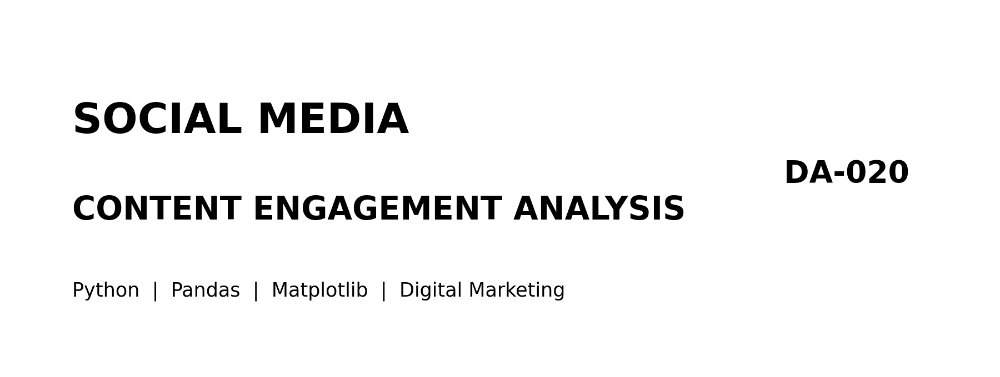
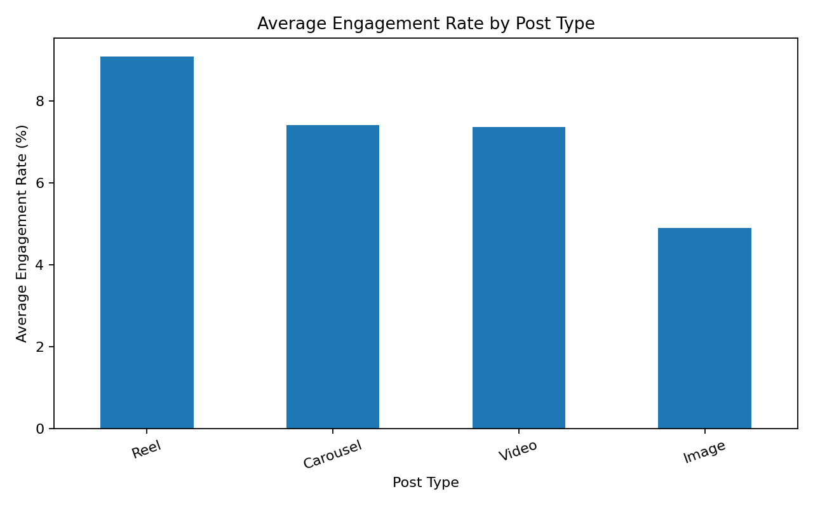
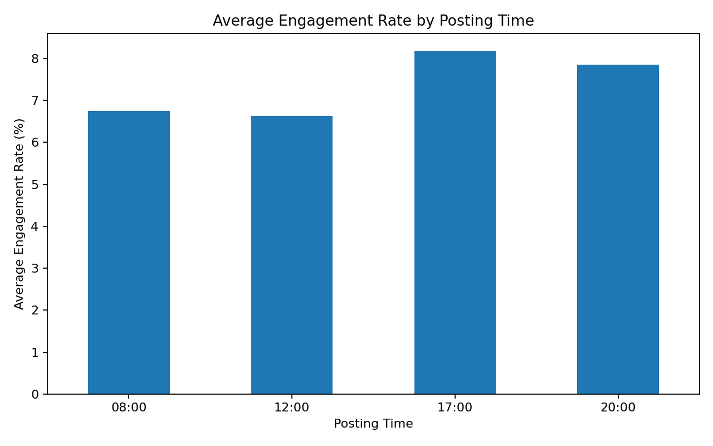
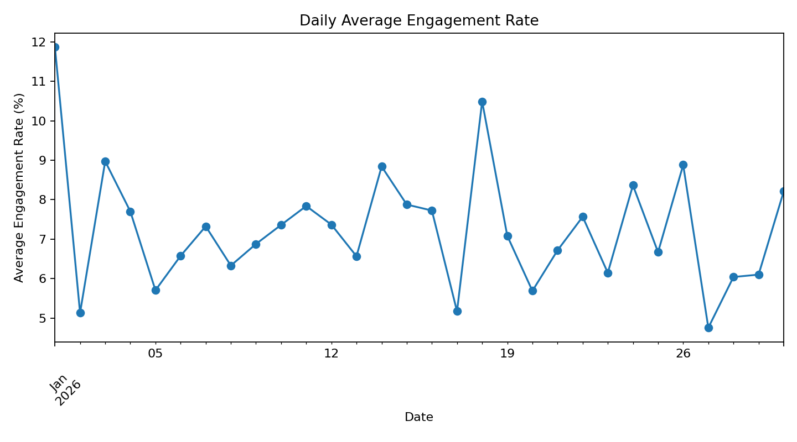
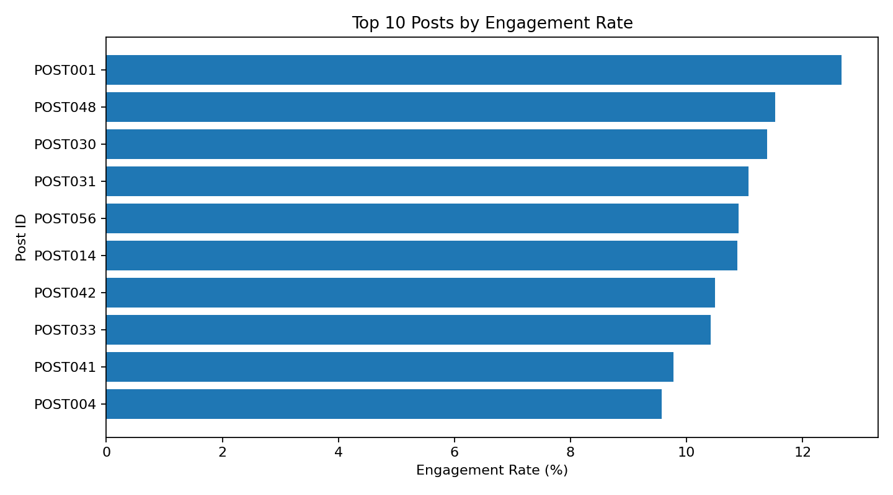

# Social Media Content Engagement Analysis



**Course:** DA-020 Digital Marketing  
**Tools:** Python · Jupyter Notebook / Google Colab · Pandas · Matplotlib · CSV

## Project Overview
Analyze post-level social media performance using impressions, reach, likes, comments, shares, post formats, dates and publishing times. The goal is to understand which formats and publishing periods are associated with stronger engagement.

> **Dataset note:** The included CSV is synthetic sample data created for this academic project. It contains no private account information and is not real campaign reporting.

## Objectives
- Calculate engagement rate with a documented denominator.
- Compare post formats and publishing times.
- Analyze engagement trends across dates.
- Rank high-performing posts.
- Recommend measurable content experiments.

## Metric Definitions
| Metric | Definition |
|---|---|
| Impressions | Number of times a post was displayed |
| Reach | Number of unique accounts that saw a post |
| Total engagements | Likes + comments + shares |
| Engagement rate by reach | (Likes + Comments + Shares) / Reach × 100 |
| Impressions-to-reach ratio | Impressions / Reach |

**Why use reach as denominator?** Reach estimates the unique audience exposed to a post. This rate describes engagements relative to that audience. It is not interchangeable with engagement rate by impressions; document the denominator in every report.

## Repository Structure
```text
Social-Media-Content-Engagement-Analysis/
├── data/social_media_posts.csv
├── images/
│   ├── project_banner.png
│   ├── engagement_by_post_type.png
│   ├── engagement_by_posting_time.png
│   ├── daily_engagement_trend.png
│   └── top_10_posts.png
├── notebooks/social_media_engagement_analysis.ipynb
├── src/analysis.py
├── README.md
└── requirements.txt
```

## Visualizations
### Engagement rate by post type

### Engagement rate by posting time

### Daily engagement trend

### Top 10 posts by engagement rate


## Run the Project
### Google Colab
1. Upload the notebook and CSV to Google Colab.
2. Keep the CSV in a `data` folder next to the `notebooks` folder, or update the CSV path in the first notebook cell.
3. Run all cells.

### Local Jupyter
```bash
git clone https://github.com/YOUR-USERNAME/Social-Media-Content-Engagement-Analysis.git
cd Social-Media-Content-Engagement-Analysis
pip install -r requirements.txt
jupyter notebook
```
Open `notebooks/social_media_engagement_analysis.ipynb`.

## Missing Data
The demonstration replaces missing numeric metrics with zero. In real reporting, a blank may mean zero, unavailable, or not yet reported. Validate the source and reporting window before imputing; document replacements or exclusions.

## Suggested Experiments
1. **Format test:** compare Reels and carousels using similar topics and consistent creative quality.
2. **Time test:** compare midday and evening slots while rotating weekdays.
3. **CTA test:** compare posts with a question or save/share prompt against posts without one.
4. **Measurement:** use multiple posts per group and compare median engagement rate, reach, shares and comments. Avoid conclusions from a single post.

## Limitations and Privacy
- Synthetic data is for learning and demonstration only.
- Topic, audience, paid promotion, platform algorithms and seasonality can affect engagement.
- Observational comparisons show association, not causation.
- Use public datasets or synthetic exports. Do not scrape or publish private account data, personal identifiers, access tokens or confidential campaign information.

## Author
Add your name, university, class/section and submission date here.
