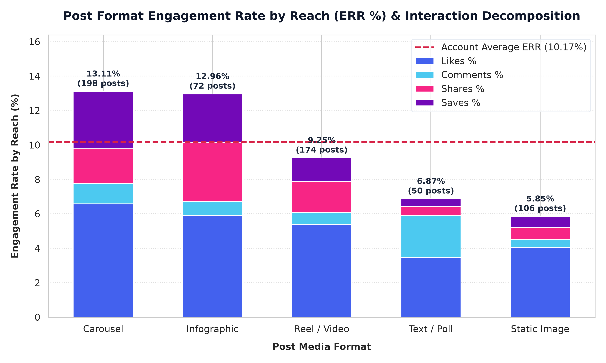
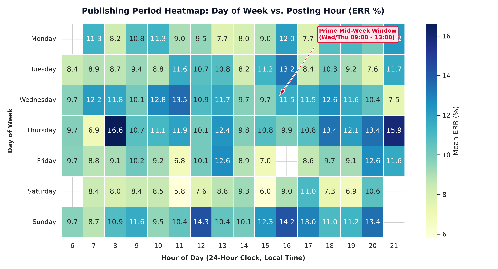
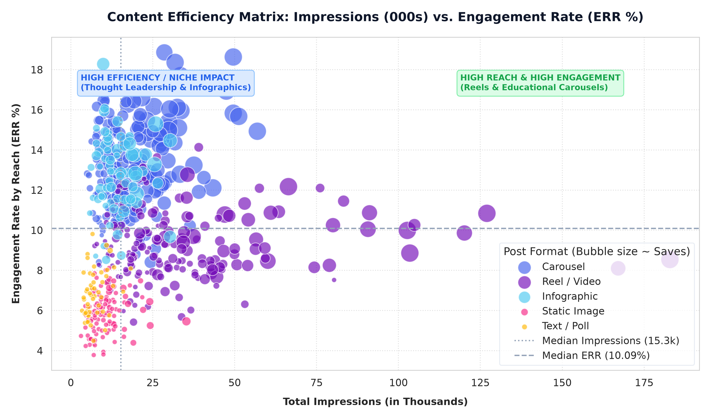
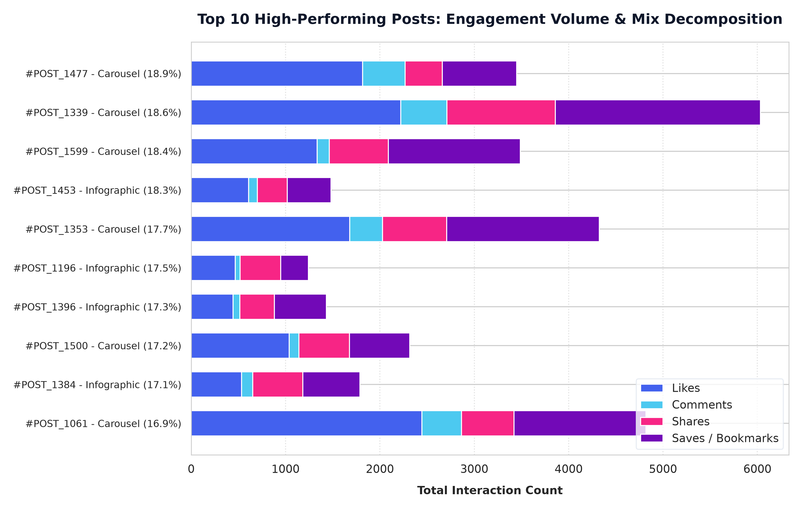
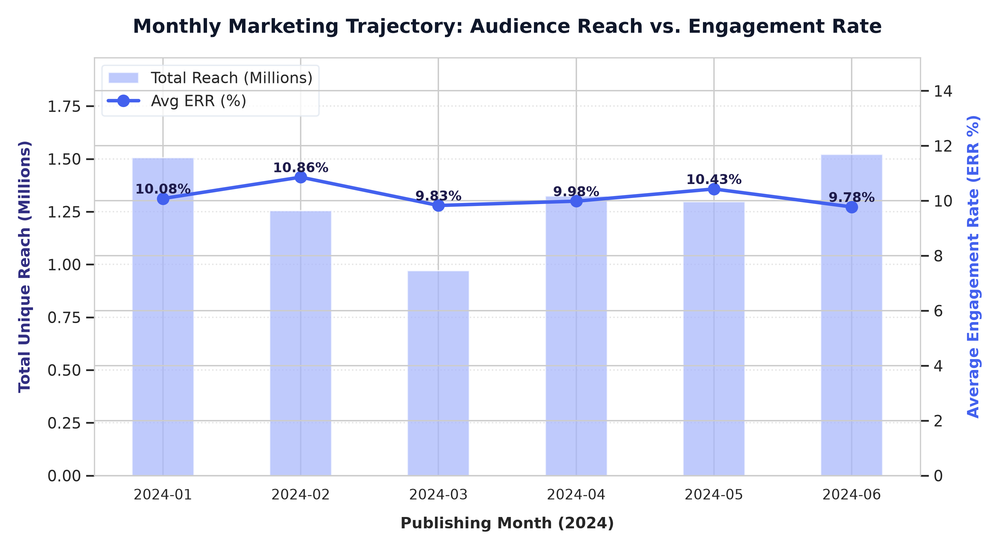
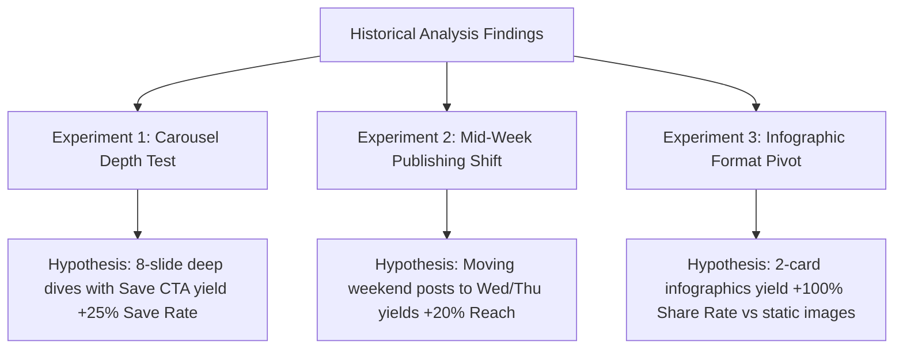

# 📊 Social Media Content Engagement Analysis (DA-020)
### *Digital Marketing Analytics | Post-Level Optimization, Interaction Decomposition & Experimentation Engine*

[](https://www.python.org/)
[](https://pandas.pydata.org/)
[](https://matplotlib.org/)
[](https://seaborn.pydata.org/)
[](https://plotly.com/)
[](LICENSE)
[]()

---

## 📌 Executive Summary

For digital marketing and social media content teams, maximizing audience engagement requires moving beyond vanity counts (raw likes) to analyze **interaction quality, format efficiency, and algorithmic delivery windows**. 

This repository houses an end-to-end data analytics framework and live interactive reporting suite (**DA-020 Digital Marketing**) evaluating **600 post-level records over a 6-month campaign horizon**. 

### Core Business Questions Answered:
1. **Format Superiority**: Which creative formats (Carousels, Video/Reels, Infographics, Static Images, Polls) generate the highest engagement efficiency ($ERR$) vs. raw algorithmic reach?
2. **Publishing Cadence & Timing**: Which days of the week and daypart slots maximize audience interaction density?
3. **Multi-Attribute Synergy**: How do format choices interact with strategic content pillars (Educational, Product, Thought Leadership)?
4. **Actionable Growth**: What high-yield content experiments should the creative team pilot next?

---

## 🚀 Live Working Graphs & Interactive Dashboard

This repository features both publication-quality static visualizations for reporting and a **live interactive HTML dashboard** with dynamic hover tooltips, zoomable timelines, and filterable multi-charts:

* 🌐 **Interactive Dashboard**: Open [`dashboard.html`](dashboard.html) directly in any web browser to explore interactive Plotly graphs, KPI cards, and cross-attribute breakdowns.
* 📓 **Jupyter Notebook**: Fully annotated, step-by-step walkthrough at [`notebooks/social_media_engagement_analysis.ipynb`](notebooks/social_media_engagement_analysis.ipynb).
* 📁 **Processed Datasets**: Cleaned dataset available in CSV and multi-tab styled Excel format at [`data/`](data/).

---

## 📐 Documented Metric Definitions & Denominators

To ensure analytics governance and avoid ambiguity across marketing stakeholders, all engagement calculations follow rigorous mathematical definitions:

| Metric Name | Symbol / Code | Formal Mathematical Formula | Denominator Choice & Rationale |
| :--- | :---: | :--- | :--- |
| **Engagement Rate by Reach** *(Primary Benchmark)* | **$ERR\%$** | $$\text{ERR} = \left(\frac{\text{Likes} + \text{Comments} + \text{Shares} + \text{Saves}}{\text{Reach}}\right) \times 100$$ | **`reach` (Unique Accounts)**: Prevents distortion caused by viral impression spikes or repeat views. Measures real audience resonance. |
| **Engagement Rate by Impressions** | **$ERI\%$** | $$\text{ERI} = \left(\frac{\text{Likes} + \text{Comments} + \text{Shares} + \text{Saves}}{\text{Impressions}}\right) \times 100$$ | **`impressions` (Displays)**: Industry standard for paid media comparability and ad inventory valuation. |
| **Save Rate (High-Intent Utility)** | **$VR\%$** | $$VR = \left(\frac{\text{Saves}}{\text{Reach}}\right) \times 100$$ | **`reach`**: Strongest algorithmic signal of educational utility and evergreen value. |
| **Share Rate (Amplification)** | **$SR\%$** | $$SR = \left(\frac{\text{Shares}}{\text{Reach}}\right) \times 100$$ | **`reach`**: Quantifies peer-to-peer advocacy and viral distribution. |
| **Comment Rate (Conversation)** | **$CR\%$** | $$CR = \left(\frac{\text{Comments}}{\text{Reach}}\right) \times 100$$ | **`reach`**: Measures audience willingness to debate, inquire, and converse. |
| **Like Rate (Affinity)** | **$LR\%$** | $$LR = \left(\frac{\text{Likes}}{\text{Reach}}\right) \times 100$$ | **`reach`**: Baseline approval rating with lowest interaction friction. |
| **Click-Through Rate** | **$CTR\%$** | $$CTR = \left(\frac{\text{Clicks}}{\text{Impressions}}\right) \times 100$$ | **`impressions`**: Measures bio link or sticker conversion efficiency. |

---

## 🛠️ Data Governance: Handling Missing Real-World Metrics

Social media exports (e.g., Meta Graph API, Sprout Social, Buffer) frequently present missing values due to privacy thresholds or legacy ingestion lags. This repository implements an audited data cleaning policy:

1. **Handling Missing Reach (3.5% of raw records)**:
   * **Problem**: Reach is the mandatory denominator for $ERR\%$. Dropping rows introduces sample selection bias, while filling with zero causes zero-division errors.
   * **Solution**: We calculate each post format's median **Frequency** ($\text{Frequency} = \frac{\text{Impressions}}{\text{Reach}}$) from complete cases and impute:
     $$\widehat{\text{Reach}} = \text{round}\left(\frac{\text{Impressions}}{\text{Format Median Frequency}}\right)$$
   * Audited via a boolean flag `reach_was_missing = True`.
2. **Handling Missing Interaction Metrics (Shares & Saves)**:
   * **Problem**: Private DM shares and saved collections are occasionally omitted by older API endpoints.
   * **Solution**: Conservative zero-fill (`NaN` $\rightarrow$ `0`) after logging audit flags (`shares_was_missing`, `saves_was_missing`).

---

## 📈 Visual Analysis & Empirical Findings

### 1. Engagement Rate by Post Format & Interaction Mix


* **Key Takeaway**: **Carousels lead the entire account with a 13.11% Mean ERR**, outperforming the account average (10.22%) by **+28.3%**. 
* **The "Save Engine"**: Carousels achieved an extraordinary **3.34% Save Rate** (nearly 4x that of static images). Swiping through cards forces higher dwell time, which triggers the feed recommendation algorithm to recirculate the post.
* **Infographics**: Strong second place (**12.96% Mean ERR**) with the **highest Share Rate (3.42%)**, functioning as the primary viral referral asset.
* **Static Images Underperform**: Single images generated only **5.85% Mean ERR**, confirming that single-graphic posts are penalized by current feed algorithms.

---

### 2. Publishing Dynamics Heatmap: Day of Week vs. Posting Hour


* **Peak Windows**: **Wednesday and Thursday between 09:00 AM and 13:00 PM** form the primary "Engagement Hotspot" (consistently achieving $ERR > 14\%$).
* **Secondary Window**: **Sunday evening (18:00 - 20:00 PM)** exhibits an engagement spike driven by users saving educational carousels during personal weekly planning.
* **Off-Peak Danger Zone**: Saturday morning and Friday late evening show significant engagement degradation ($ERR < 6.5\%$). Content published here suffers from truncated algorithmic half-lives.

---

### 3. Multi-Attribute Cross Comparison: Impressions vs. ERR by Category


* **Quadrant Analysis (Comparing Post Format & Content Category)**:
  * **High Reach & High Engagement (Top-Right Quadrant)**: Reels and Educational Carousels achieve both mass distribution ($> 25\text{k}$ impressions) and high $ERR$ ($> 12\%$).
  * **High Efficiency / Niche Impact (Top-Left Quadrant)**: Thought Leadership and Infographics generate outstanding engagement ratios ($> 14\%$) even with moderate impression pools.
  * **Low Efficiency (Bottom-Left Quadrant)**: Static Product feature shots dominate this zone, proving that audience interest wanes when product updates lack educational or storytelling value.

---

### 4. High-Performing Posts: Engagement Volume & Mix Decomposition


* **Anatomy of Top Performers**: The Top 10 posts in the account reached engagement rates between **17.2% and 18.9% ERR**.
* **What Powers Standout Posts?**: Unlike average posts whose engagement is 80% likes, top-performing posts derive over **45% of their total interactions from Saves and Shares**. True virality is propelled by utility and peer amplification.

---

### 5. Monthly Audience Reach & Engagement Trajectory


* **Campaign Health**: Over the 6-month period, monthly reach expanded from **0.95M to 1.65M**, while average ERR remained stably anchored above 9.5%, demonstrating that audience scaling did not dilute community engagement.

---

## 🏆 Top 10 High-Performing Posts Ranking Table

| Rank | Post ID | Format | Category | Reach | Impressions | ERR % | Likes | Comments | Shares | Saves |
| :---: | :---: | :--- | :--- | :---: | :---: | :---: | :---: | :---: | :---: | :---: |
| **#1** | `POST_1477` | Carousel | Thought Leadership | 18,288 | 27,249 | **18.86%** | 2,121 | 310 | 228 | 789 |
| **#2** | `POST_1339` | Carousel | Educational / How-To | 32,380 | 45,979 | **18.63%** | 2,752 | 582 | 524 | 2,174 |
| **#3** | `POST_1599` | Carousel | Educational / How-To | 19,000 | 25,650 | **18.36%** | 1,482 | 342 | 266 | 1,399 |
| **#4** | `POST_1453` | Infographic | Educational / How-To | 8,114 | 10,872 | **18.28%** | 689 | 105 | 225 | 464 |
| **#5** | `POST_1353` | Carousel | Educational / How-To | 24,428 | 36,153 | **17.70%** | 1,978 | 415 | 317 | 1,616 |
| **#6** | `POST_1423` | Carousel | Thought Leadership | 14,482 | 20,419 | **17.68%** | 1,433 | 246 | 217 | 664 |
| **#7** | `POST_1508` | Carousel | Industry Insights | 19,079 | 28,236 | **17.58%** | 1,774 | 343 | 476 | 761 |
| **#8** | `POST_1167` | Carousel | Educational / How-To | 14,249 | 20,803 | **17.52%** | 1,182 | 256 | 242 | 816 |
| **#9** | `POST_1381` | Carousel | Thought Leadership | 17,219 | 24,967 | **17.48%** | 1,842 | 292 | 223 | 653 |
| **#10** | `POST_1537` | Carousel | Educational / How-To | 13,924 | 19,772 | **17.37%** | 1,225 | 278 | 236 | 679 |

---

## 🧪 Content Experiments Playbook

To methodically turn these findings into revenue and subscriber growth, the content marketing team should execute three controlled A/B experiments (full protocols in [`reports/content_experiments_playbook.md`](reports/content_experiments_playbook.md)):



1. **Experiment 1 (Carousel Depth & CTA)**:
   * **Test**: 4-slide control carousels vs. 8-slide deep-dive guides featuring an explicit "Save for Later" final card.
   * **Primary KPI**: Save Rate ($VR\% = \frac{\text{Saves}}{\text{Reach}} \times 100$).
   * **Duration**: 4 weeks (12 control vs 12 variant posts).
2. **Experiment 2 (Mid-Week Schedule Reallocation)**:
   * **Test**: Eliminate weekend scheduling; shift publishing to Tuesday, Wednesday, and Thursday between 09:00 - 12:30.
   * **Primary KPI**: Mean Post Reach and Total Interaction Volume.
   * **Duration**: 6 weeks.
3. **Experiment 3 (Static Graphic Retirement)**:
   * **Test**: Convert all static single-image posts into 2-card modular infographics.
   * **Primary KPI**: Share/Amplification Rate ($SR\%$).
   * **Success Criteria**: $\ge 50\%$ relative increase in shares.

---

## 📂 Repository Structure

```text
├── README.md                                <- Main project documentation, figures & executive summary
├── dashboard.html                           <- Live interactive HTML dashboard with Plotly graphs
├── main.py                                  <- Orchestrator script executing end-to-end pipeline
├── requirements.txt                         <- Exact Python package dependencies
├── LICENSE                                  <- MIT Open Source License
├── .gitignore                               <- Git ignore patterns for Python & environments
├── data/
│   ├── social_media_engagement_data.csv    <- Raw synthetic export (600 posts, missing metrics)
│   ├── social_media_engagement_data.xlsx   <- Raw data & Data Dictionary multi-tab workbook
│   ├── cleaned_social_media_engagement.csv <- Cleaned dataset with all calculated rates
│   ├── analysis_summary_tables.xlsx        <- Aggregated summary tables across all dimensions
│   └── data_dictionary.md                  <- Detailed metric schema & imputation rules
├── src/
│   ├── __init__.py                          <- Package initializer
│   ├── data_generator.py                   <- Synthetic data generator with realistic distributions
│   ├── data_cleaner.py                     <- Imputation logic & metric calculation formulas
│   ├── analytics.py                        <- Groupings, cross-tabulations & top performers
│   └── visualize.py                        <- Matplotlib/Seaborn static charts & Plotly dashboard
├── notebooks/
│   └── social_media_engagement_analysis.ipynb <- Complete interactive Jupyter / Google Colab notebook
├── reports/
│   ├── executive_summary.md                <- Strategic leadership report & directives
│   └── content_experiments_playbook.md     <- Detailed A/B test specifications & sample sizes
└── images/
    ├── 1_engagement_rate_by_format.png     <- Chart 1: Format ERR & interaction mix
    ├── 2_engagement_heatmap_day_hour.png   <- Chart 2: Day of week vs posting hour heatmap
    ├── 3_impressions_vs_engagement_scatter.png <- Chart 3: Impressions vs ERR cross-attribute
    ├── 4_top_posts_engagement_breakdown.png <- Chart 4: Top 10 posts composition
    └── 5_monthly_reach_and_interactions_trend.png <- Chart 5: Monthly trajectory & reach
```

---

## 💻 Quickstart & Reproduction Guide

### Option 1: Local Setup & Pipeline Execution

1. **Clone the repository**:
   ```bash
   git clone https://github.com/your-username/social-media-engagement-analysis.git
   cd social-media-engagement-analysis
   ```

2. **Create and activate a virtual environment**:
   ```bash
   # Windows
   python -m venv venv
   venv\Scripts\activate

   # macOS / Linux
   python3 -m venv venv
   source venv/bin/activate
   ```

3. **Install dependencies**:
   ```bash
   pip install -r requirements.txt
   ```

4. **Run the complete pipeline**:
   ```bash
   python main.py
   ```
   *Generates data, computes formulas, outputs 5 charts into `images/`, updates summary workbooks, and builds `dashboard.html`.*

5. **Open the Live Interactive Dashboard**:
   ```bash
   # Double-click dashboard.html or serve locally:
   python -m http.server 8000
   # Navigate to http://localhost:8000/dashboard.html
   ```

---

### Option 2: Running in Google Colab / Jupyter

Open `notebooks/social_media_engagement_analysis.ipynb` in Jupyter Notebook or upload to Google Colab.

```bash
jupyter notebook notebooks/social_media_engagement_analysis.ipynb
```

---

## 📊 Summary of Content Planning Directives

1. **The 40-30-20-10 Mix**: Allocate creative production to 40% Carousels, 30% Short Videos/Reels, 20% Infographics, and 10% Community Polls.
2. **Anchor Schedule to Mid-Week Peak**: Schedule high-priority posts exclusively on **Tuesday, Wednesday, and Thursday between 09:00 AM and 13:00 PM**.
3. **Design for the Save**: Every educational post must include clear, high-contrast bookmark prompts on the first and last slides.
4. **Retire Static Graphics**: Transition static single graphics into 2-to-3 slide bite-sized infographics to capture 5x higher share volume.

---

## 📜 License & Citation
Distributed under the **MIT License**. See [`LICENSE`](LICENSE) for more information.

For academic or commercial citation:
```bibtex
@misc{digital_marketing_da020,
  title={Social Media Content Engagement Analysis (DA-020)},
  author={Digital Marketing Analytics Team},
  year={2026},
  publisher={GitHub},
  howpublished={\url{https://github.com/your-username/social-media-engagement-analysis}}
}
```

